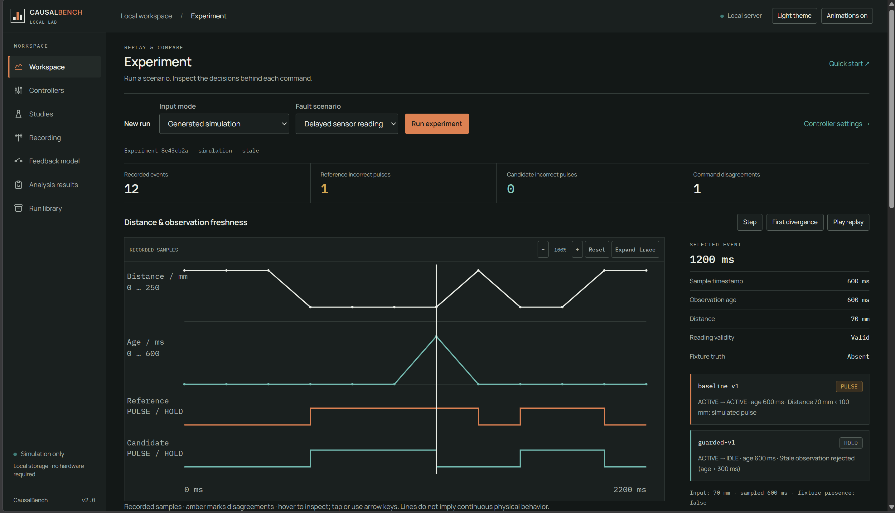
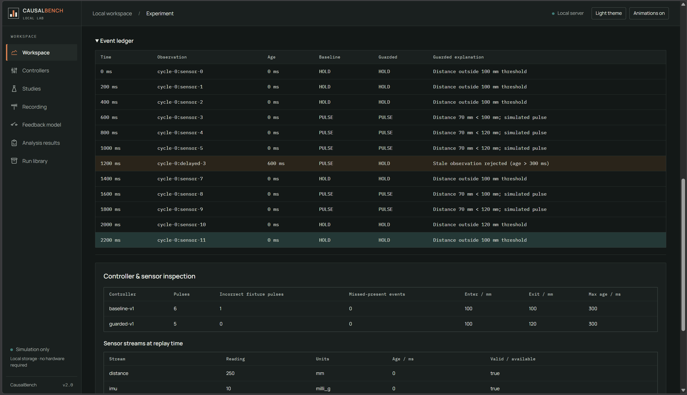
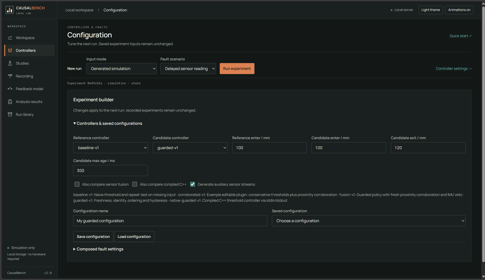
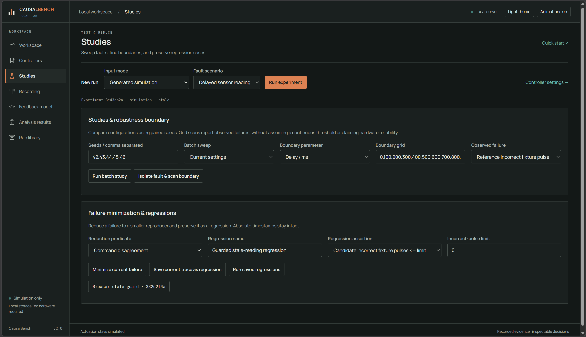
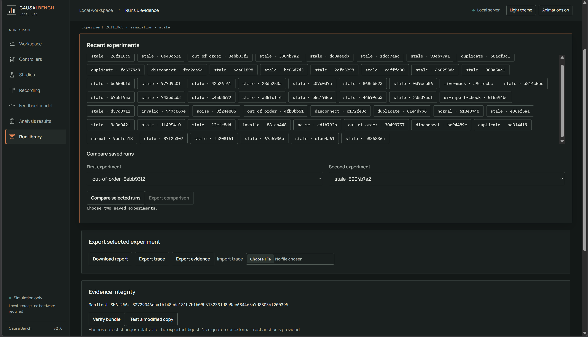
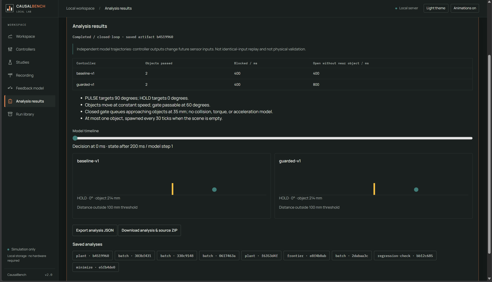

# CausalBench 2.0

[](https://github.com/abhishekkr10/CausalBench/actions/workflows/validate.yml)

CausalBench reproduces sensor/controller failures using timestamped traces, repeatable faults, decision replay and source-and-evidence exports.

At **1200 ms**, the delayed-reading example presents a **600 ms-old** distance of **70 mm**. The baseline pulses; the guarded controller rejects the stale reading and holds. Actuation is simulated. The physical-output adapter is intentionally unavailable.



```text
Generate / import / capture -> validate -> inject faults -> replay policies
 -> inspect disagreement -> minimize -> save regression / export evidence
```

## Quick start

```sh
git clone https://github.com/abhishekkr10/CausalBench.git
cd CausalBench
```

On Windows, double-click **Open CausalBench.cmd** to start the server in the
background and open the browser. Run it again after restarting Windows.
It reuses a healthy running instance. Python must be installed and on PATH.
For a foreground server with explicit shutdown, use the command below.

## Start

Tested on Windows with Python 3.13.7. The Python application uses only the standard library. A C++ compiler is needed only to rebuild native plugins; the supplied Windows example has already been compiled and tested.

```powershell
python -m causalbench.server --port 8767
```

Open http://127.0.0.1:8767. Stop with Ctrl+C. SQLite is `data/experiments.sqlite`; `--database PATH` selects another file. The application is for a trusted local machine and listens only on loopback. Reload the browser after editing web files; restart the service to activate Python source changes. Source archives retain the Python implementation loaded by the process, rather than relabelling it after edits.

## Validation and scope

The documented local suite contains **93 Python tests** and **13 browser workflows**. Python checks cover trace contracts, replay, faults, provenance and lab features. Browser workflows exercise experiment and evidence flows. The 93 Python tests passed locally during the 5 November review; that is separate from hosted CI.

The [remote run checked on 5 November](https://github.com/abhishekkr10/CausalBench/actions/runs/41569986802) failed at the Python-test step. The badge shows current status and is not an unconditional passing claim.

```sh
python -m unittest discover -s tests -v
npm ci
npx playwright install --with-deps chromium
npm run test:browser
```

This is a trusted local lab. Native adapters are trusted installed code, not a general hostile-code sandbox. Capture has documented host-side timestamp uncertainty, and simulated output does not establish physical actuator behavior.

## What is available

The dashboard includes paper/light and charcoal/dark themes, readable controls,
responsive navigation, blur-to-focus entrances, hover enlargement, and a saved
reduced-motion preference. The numbered event strip synchronizes replay and
highlights disagreements. Use the sidebar to reach the builder, studies,
recording, feedback model, and evidence tools.

The recorded trace chart shows distance, observation age and controller commands,
with cursor-driven readings and synchronized keyboard/touch selection. The optional first-experiment
walkthrough runs labelled examples, explains decisions, and verifies/exports
evidence. Recent experiments can be compared and their comparison exported;
changed inputs are explicitly distinguished from identical-input comparisons.
See the [roadmap](docs/ROADMAP.md) for remaining milestones.

1. Composed seeded faults: delay, drop, duplicate, reordering, invalid values, noise, and auxiliary sensor disconnection.
2. Per-controller tuning and named SQLite configuration profiles.
3. Paired-seed batch studies with fault and configuration sweeps.
4. Saved regression assertions and a headless command with meaningful exit codes.
5. Bounded failure minimization with absolute timestamps and a 1-minimality certificate when completed.
6. Declarative controller plugins and a compiled C++ stdin/stdout adapter.
7. Live mock or HTTP sensor recording, bounded recent-event buffering, diagnostics, and snapshots.
8. Auxiliary sensor streams, per-event inspection, and a corroboration controller with an IMU veto.
9. A separate closed-loop gate/queue model with controller-dependent sensor trajectories.
10. Reproducibility ZIPs for experiments and analyses, archived sources/binaries, inspection, import, and offline reruns.

Additional investigation tool: robustness-boundary scanning across an explicit fault grid. It reports observed failures without assuming monotonicity or claiming a continuous physical threshold.

## First demo

Run Delayed sensor reading, then First divergence: baseline pulses at 1200 ms on a 600 ms-old sample; guarded holds. In Research tools, optionally add the fusion and compiled C++ policies and run again. Minimize current failure, inspect the one-event reproducer, save a regression, and run it. Download its source/evidence ZIP.

Try a second example using `examples/sensor-corroboration.json`: a fresh but incorrect primary reading can evade freshness checks, while an independent proximity observation vetoes the command. This is a labelled simulated assumption, not a claim of real sensor reliability.

## Headless commands

```powershell
python -m unittest discover -s tests -v
python -m causalbench.lab_cli controllers
python -m causalbench.lab_cli experiment --input examples/sensor-corroboration.json --output data/corroboration.bundle.json
python -m causalbench.lab_cli batch --input examples/batch.json --output data/batch.json
python -m causalbench.lab_cli frontier --input examples/boundary.json --output data/boundary.json
python -m causalbench.lab_cli plant --input examples/plant.json --output data/plant.json
python -m causalbench.lab_cli regressions --input examples/regressions.json --output data/regression-check.json
```

Without `--input`, the regression command checks cases saved in the selected SQLite database. An empty suite exits with an error; failing or unknown assertions exit 1. All-pass exits 0. These commands can be used in CI. GitHub Actions is configured for Python tests, native builds and browser checks on Windows, Linux and macOS. See the validation section and linked Actions runs for hosted results.

Original `causalbench.cli run`, `capture`, and `verify` commands remain available. For a stored experiment, `python -m causalbench.lab_cli package --run-id ID --output data/run.zip` exports its archived implementation.

## Native example

```powershell
g++ -std=c++17 -O2 -static controllers/native_guarded.cpp -o controllers/native_guarded.exe
```

On a non-Windows host the expected example filename is `controllers/native_guarded`. That platform has not been exercised here. Build details for the actual Windows compilation are in `controllers/build_manifest.json`. If no native executable is installed, the Python lab still works and the dashboard disables the native comparison checkbox.

## Project structure

| Path | Purpose |
|---|---|
| `causalbench/` | Replay engine, API, SQLite store, controllers, studies and archives |
| `web/` | Dependency-free HTML/CSS/JavaScript dashboard |
| `controllers/` | Declarative plugin, C++ source, Windows executable and build manifest |
| `examples/` | Reproducible experiment and analysis request JSON |
| `firmware/` | Optional ESP32 sensor sketch and credential template |
| `tests/` | Python unit and integration tests |
| `docs/` | Workflows, validation, project history, roadmap and screenshots |
| `start_causalbench.py` | Background server launcher used by the Windows shortcut |

`data/` is created locally and excluded from Git: it contains SQLite databases,
capture/evidence artifacts and server logs. Wi-Fi credentials, environment
secrets, caches and virtual environments are also excluded. The Windows native
example is included with source and a checksum; rebuild it if needed.

## Read next

- [Current status](current_status.md): implemented features and known limitations.
- [Roadmap](docs/ROADMAP.md): next steps and completion criteria.
- [Development history](docs/DEVELOPMENT_HISTORY.md): work completed to date.
- [Contributing](CONTRIBUTING.md): local development and checks.

- [docs/EXPERIMENT_WORKFLOWS.md](docs/EXPERIMENT_WORKFLOWS.md): all tools, examples, contracts, and limits.
- [docs/DETAILED_REPORT.md](docs/DETAILED_REPORT.md): motivation and module explanations, plus the 2.0 extension.
- [architecture.md](architecture.md): schemas, clock domains, trust and persistence.
- [docs/VALIDATION.md](docs/VALIDATION.md): exact commands and actual results.
- [docs/HARDWARE_GUIDE.md](docs/HARDWARE_GUIDE.md): optional device profile and wiring.
- [docs/DEMO_SCRIPT.md](docs/DEMO_SCRIPT.md): short and extended demonstrations.

## Limits that matter

Open-loop replay compares fixed-input software decisions; disagreement alone is not failure. Closed-loop results depend on the stated model. No physical servo driver, firmware flashing, physical sensor accuracy, or physical latency validation is claimed. HTTP capture uses host request-start as a sample-time estimate and retains unsynchronized device times separately. Capture snapshots without fixture labels report outcome errors as Unknown.

ZIP hashes establish consistency, not authenticity. Imports inspect archived code without running it; they use installed controllers for imported traces. Only run a manually extracted archive when you trust its source. The environment is described, not an included Python installation or universal container. Native artifacts require their OS/runtime.

The trace limit is 10000 events / 2 MB. Generated studies allow 1000 events, minimization 300, native replay 1000, and the gate model 200 steps / up to three non-native controllers. See the workflow guide for full bounds. Back up SQLite while the service is stopped.

## Open the dashboard on Windows

Double-click `Open CausalBench.cmd` in the project folder. It starts the local
server in the background if needed, waits for it to become ready, and opens
http://127.0.0.1:8767/. Reopening the launcher reuses the running server.
Run it again after restarting Windows. Python must be installed and on PATH.
Server output is saved in `data/server.log`.

The top-bar theme button switches between light and dark. The choice is saved
in this browser; before an explicit choice, the system theme is used.

## Browser checks and curated examples

```powershell
npm ci
npx playwright install chromium
npm run test:browser
```

On Windows, use an installed Edge browser if needed:
`$env:CAUSALBENCH_BROWSER='msedge'; npm run test:browser`.
These are development dependencies only; running the application still needs only Python.
The browser suite starts a separate server on port 8768 using `data/browser-tests.sqlite`.

Named requests: `examples/demo-stale.json`, `examples/demo-duplicate.json`,
`examples/demo-disconnect.json`, and `examples/sensor-corroboration.json`. Run any
with `python -m causalbench.lab_cli experiment --input PATH --output data/demo.json`.

Licensed under the [MIT license](LICENSE).

## Figma design integration

The supplied Figma concept is integrated with the real experiment service: paper
and charcoal themes, orange actions, a selected-event inspector, locally bundled
Manrope/IBM Plex Mono fonts, chart zoom, and an expanded trace dialog. Every
workspace remains available on mobile. Motion and blur effects respect reduced
motion. The design prototype's illustrative results and placeholder actions are
not used as experiment evidence. See [design notes](docs/FIGMA_INTEGRATION.md) and
[refinement prompts](docs/FIGMA_REFINEMENT_PROMPTS.md).

## Dashboard gallery

Screenshots supplied by the project owner, captured on 2 November 2026. They show
local simulation runs; no physical sensor or actuator validation is implied.

### Replay and controller decisions

Hover over the chart to select the nearest recorded event. The inspector, command
explanations, replay slider and ledger update together. Zoom/reset and expanded
inspection retain the original recorded values. Animations include hover emphasis,
line highlighting and scroll blur; select **Animations on** / **Enable animations**
to control motion. System reduced-motion preferences are respected.



### Controllers and faults

Select controller policies, tune thresholds and sample age, save profiles, and
compose seeded faults for the next run.



### Research studies and regression checks

Run paired-seed batches, explicit-grid boundary scans, bounded failure reduction
and saved regression assertions. Completed jobs open in Analysis results.



### Saved runs and evidence

Reopen experiments, compare recorded inputs/configurations, verify evidence,
and export traces, reports or source-and-evidence packages.



### Feedback analysis

Inspect independent simulated gate trajectories and their stated assumptions.
These are model results, not measured hardware performance.


